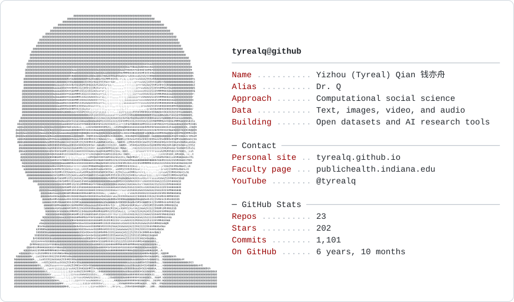

<picture>
  <source media="(prefers-color-scheme: dark)" srcset="card-dark.svg">
  
</picture>

  <a href="https://tyrealq.github.io">Website</a> ·
  <a href="https://scholar.google.com/citations?user=1FtSN0gAAAAJ&hl=en">Google Scholar</a> ·
  <a href="https://youtube.com/@tyrealq">YouTube</a>

